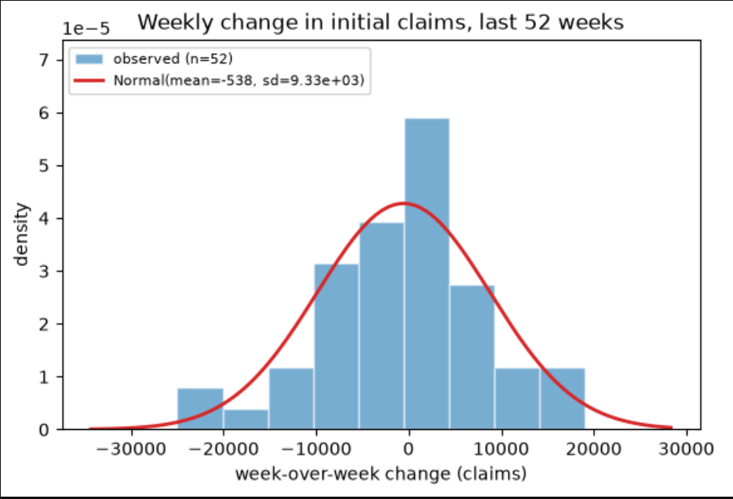
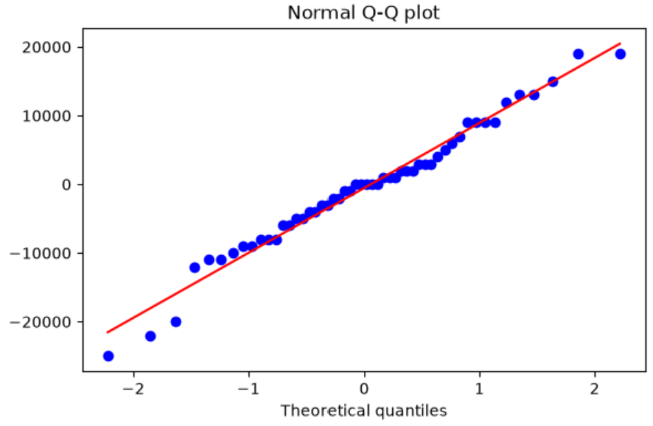
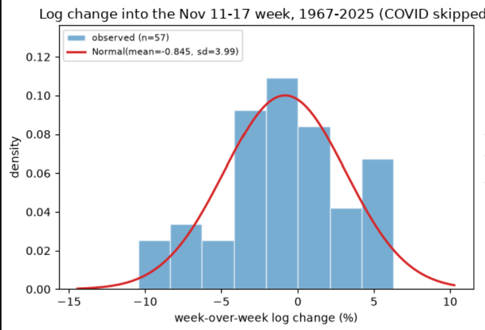

# Initial jobless claims for the week ending November 14, 2026, at least 200,000

Forecasting

*The reasoning behind my call on Will initial jobless claims for the week ending November 14, 2026 be at least 200,000?*

## I. Reference class selection

Initial jobless claims for the week of Nov ending in 19. Close date is 19.

The quantity we care about here is the initial jobless claim. New people who claimed unemployment benefits from the US government. It is calculated by the Department of Labor and reported every week.

It is similar to Will the S&P 500 close above 7,500 at the end of 2026 in the fact that it is asking for a threshold where our initial jobless claim $I \geq 200{,}000$. The question does have a list of different threshold values. I chose to work on $I \geq 200{,}000$.

The initial job claim is extremely volatile because it is calculated every week. The procedure I follow for this type of question is that I anchor on a past value to see if a shift will bring the value over the threshold. I anchored on the Nov 7 number, 200,000. A reference class selection based on this anchor is looking at the normal week-to-week initial claims for the last 52 weeks (mid-Nov 2025 to now), excluding 2020-21. We calculate the standard deviation from each week to the next.

In the calculations I am skipping the years 2020-21 because of COVID. Those were times when we saw an abnormal rise in the number of jobless claims. It went from 200k to millions per week within a few weeks in March 2020 <!-- #number -->. Because of these factors, it's hard to estimate the overall trend including those years, because they skew the data.

Another factor that affects our initial job claim value is that Veterans Day, which is a national holiday, is Nov 11. That means one less day for people to file their claims. People who would have gone to claim their benefits on Wednesday instead go next week.

I pulled from the FRED dataset,[^1] cleaned up the data to remove any missing values, and converted the date string into a datetime object. I sorted the dates in ascending order and defined a window of 53 weeks for the standard deviation calculation.

## II. Math logic

I then used that window to calculate the weekly log changes <!-- #why --> and the standard deviation. The SD of the weekly change is 9,327. The SD of the log change came to be 0.443.

$P(\text{claims} \geq 200{,}000)$ using a standard deviation ($\sigma$) of 9,327. We assume that this week's claims are normally distributed, centered on the last observed level. The $\sigma$ is the spread. I used the normal distribution here because it's a modeling assumption that can be made reasonably.

If this week's claims are $X \sim \mathcal{N}(\mu, \sigma^2)$, the probability density function is

$$f(x) = \frac{1}{\sigma \sqrt{2\pi}}\exp\left(-\frac{(x-\mu)^2}{2\sigma^2}\right)$$

Once $\mu$ and $\sigma$ are fixed, the density, and so every probability, is determined. Here $\mu$ is the mean of the distribution and $\sigma$ is its standard deviation.

**From density to probability**

A probability is an area under the density:

$$P(X \ge a) = \int_{a}^{\infty} f(x)\,dx$$

This integral has no closed form, so standardize with $z = \dfrac{a-\mu}{\sigma}$ and use the standard normal CDF $\Phi$:

$$P(X \ge a) = 1 - \Phi\!\left(\frac{a-\mu}{\sigma}\right)$$

**Application (claims, week ending Nov 14)**

With $\sigma = 9{,}327$ and $a = 200{,}000$:

$$P(X \ge 200{,}000) = 1 - \Phi\!\left(\frac{200{,}000-\mu}{9{,}327}\right)$$

- $\mu = 200{,}000$ (last level): $z = 0$, so $P = 0.50$
- $\mu \approx 195{,}000$ (4-week average): $z \approx 0.536$, so $P \approx 0.30$

The final $P(\text{claims} \geq 200{,}000) = 0.52$. This makes me skeptical of two things because it's an order of magnitude away from the community prediction on [Kalshi](https://kalshi.com/markets/kxjoblessclaims/weekly-initial-jobless-claims/kxjoblessclaims-26nov19):

1. The normal distribution modeling assumption is wrong.
2. The reference class selection, sampling from 52 weeks of this year, is a wrong approach.
   1. This seems plausible because of two things. This week of November has the Labor Day weekend. I do not know how much this affects the results, but I aim to find out.

We will have to check it using a histogram of all the initial claims for the 52 weeks I sampled.

<!-- #figdescription -->

## III. Nov focused reference class selection

To explore the effects of Labor Day being on this week of November, I pulled the initial job claim values for the week Nov 11-17 in every past year, including the Labor Day on Nov 14. I calculated the standard deviation just like I did previously, also checking the assumptions of the normal distribution of the spread.

<!-- #figvalue -->

The standard deviation here is 8,000 depending on the start year we looked at, around a 1,000 difference from the yearly reference class.

How do we validate the reference class selection?

Why do we check sensitivity to the start year?

## Appendix: the code

The notebook is on GitHub: NWelde/predictions.

## Footnotes

[^1]: [FRED, Initial Claims (ICSA)](https://fred.stlouisfed.org/graph/fredgraph.csv?id=ICSA)
